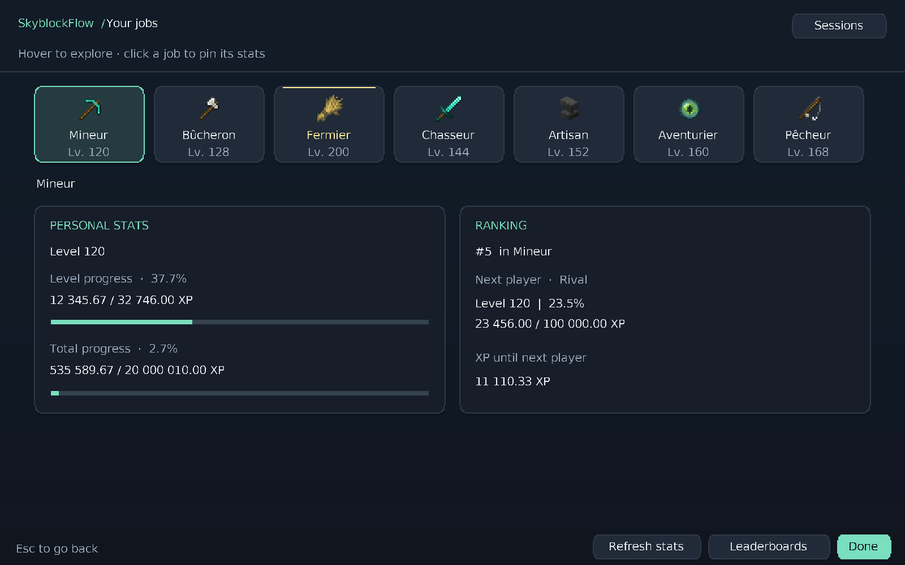
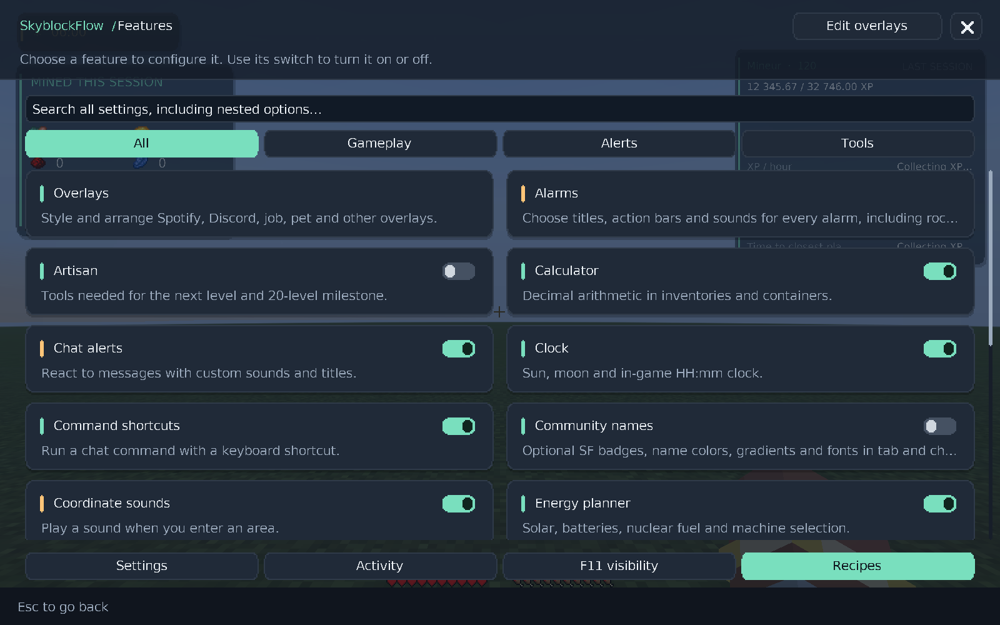
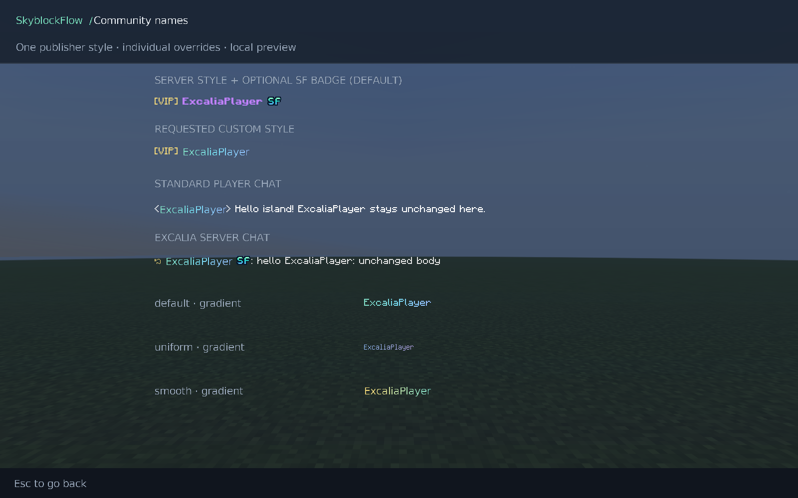
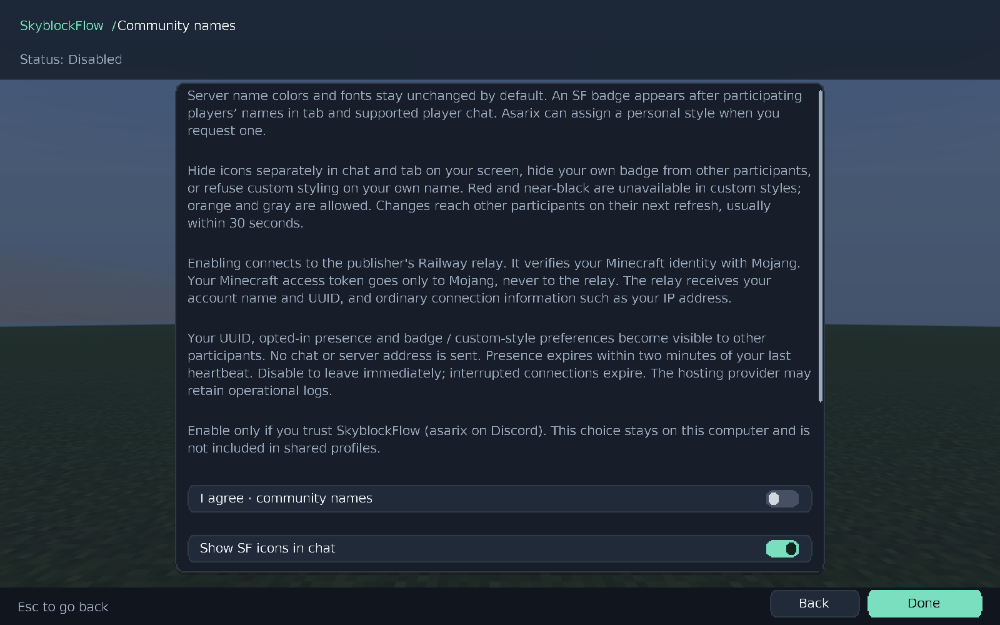
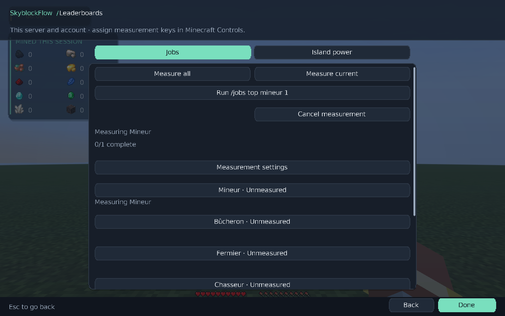
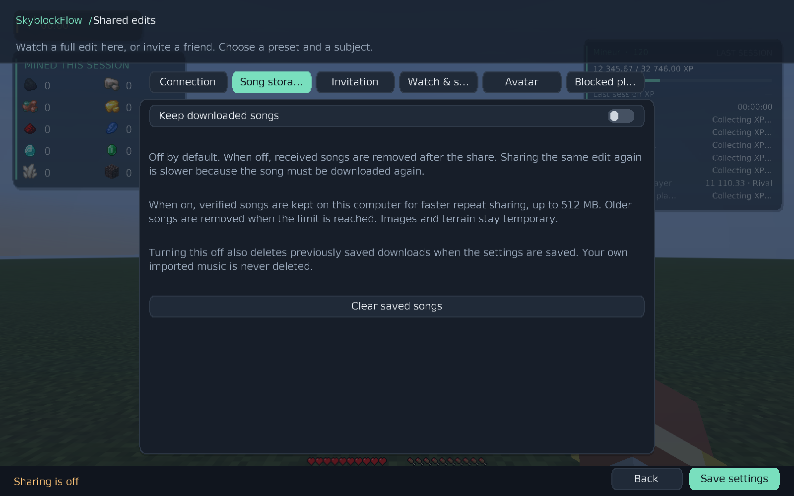

# SkyblockFlow


A client-side Minecraft companion for Excalia: follow your progress, plan your island, arrange your HUD, and share a cinematic moment with a friend.

**Minecraft 26.2 · Fabric · Java 25 · MIT**



## Get started

Install Fabric Loader **0.20.1** and Fabric API **0.161.0+26.2** in a Minecraft 26.2 instance, then place the SkyblockFlow JAR in its `mods` folder. Start the game and press **F7**, or run **`/skyblockflow`**.

Choose a feature to configure it. Search includes settings inside nested menus. Settings and overlay layouts save when closed; invalid values stay open for correction. Imports, deletion and account authorization require an explicit action.

Download [PUBLIC-BETA-0.0.1](https://github.com/AsarixLeDev/SkyblockFlow/releases/tag/PUBLIC-BETA-0.0.1). The Discord overlay cannot connect in this release while public access is being verified. See [Discord availability](DISCORD-RELEASE.md).

## Features

| Feature | What it does |
| --- | --- |
| **Job tracker** | Keeps independent sessions for simultaneous jobs; the overlay follows the latest XP gain. Overlapping sessions use confirmed boss-bar XP. Tracks job level, XP, session gains, pace and time to the next level, milestone and level 200. Reconciles action-bar gains with server boss bars and the equipped pet's bonus. Optional controls hide the XP boss bar, jobs strip and idle footer. |
| **Jobs dashboard** | `/jobs stats` opens job icons with personal progress and rankings. Hover to explore; click to pin. Level 200 and first place receive gold highlights, or readable rainbow text when both are reached. The original server menu remains selectable. |
| **Leaderboards** | Shows ranks, the next rival, or the gap ahead of second place when leading. Caches observed players and island power. Measurement replies stay out of chat even if a lookup fails. A manual measurement displays each command for you to click; it never runs the next command automatically. Normal `/jobs stats` and `/is visits` observations also update the cache. |
| **Pet tracker** | Displays the equipped pet's icon, XP, level, food and hunger estimate. Alerts when hungry and pauses the hunger clock while outside a world. Open `/pets` to refresh server data. |
| **Spawner helper** | Highlights activation distance and checks the surrounding 5×5×5 spawning area. Orange warnings mark obstructions and hostile-spawner lighting; other spawners can be exempted. Uses loaded client data. |
| **Waypoints and maps** | Organizes colored checkpoints into sets and categories, with labels, visibility zones, a minimap, recorded surface maps, copy/offset tools and walking/flying route guidance. [Waypoints guide](WAYPOINTS.md). |
| **Inventory calculator** | A compact arithmetic bar in inventories and containers, with parentheses, decimal calculations, a scrolling expression and a result that fits the bar. |
| **Recipe helper** | Browse and search items beside your inventory. Check recipes and uses, pin favorites, and track the ingredients you need against your inventory and an optional open container. |
| **Shop values** | Replaces recognized shop-price lore with job-adjusted unit and stack prices. Preserves unrelated lore and identifies unavailable level information. |
| **Mineral counter** | Counts selected ore blocks mined this session, with item icons. |
| **Artisan calculator** | Estimates how many craftable tools are needed for the next level or next multiple of 20, across a configurable number of tool tiers. |
| **Energy planner** | Saves solar panels, matching batteries, nuclear generators, fuels, all 12 effect emitters and machine demand. Emitter consumption follows the chosen effect level. Predicts supply and battery depletion times. Select machines in the world to fill a plan; ordinary blocks and cables are ignored, while unknown machines appear pale red and can be assigned a type or removed. Right-click a saved machine to read its real menu and update its type, installed battery and chosen emitter level, even outside selection mode. Open each panel once to remember its battery; inserting or removing it updates the plan while its menu is open. The menu offers a planner shortcut; block/menu observations stay available under Detected data. Highlights can be hidden. Locations and custom consumption values are saved. |
| **Clock and daily claims** | Shows in-game HH:mm with a sun/moon and optional day/night colors. A daily reminder says “DO YOUR DAILY CLAIMS” at 23:55 in your computer's local time while the game is running. |
| **Rocket League** | Optional Liquipedia live/upcoming match overlay with teams, available logos, series/game scores and event name. Hidden by default without a live match or one within 24 hours. Polling increases near matches; manual refresh has a one-minute cooldown. |
| **Chat alerts and tools** | Configurable template/regex message alerts, sound/title choices, clickable chat copying, repeated-message compression across the last five minutes, and command shortcuts that run only during gameplay. Default alerts cover skill availability, private messages and pet hunger. |
| **Coordinate sounds** | User-created alerts when entering an area. No personal coordinates are bundled. |
| **Timers and alarms** | One-shot or repeating timers, hungry-pet and rank alerts, optional ancient-debris and rocket-oxygen warnings, with configurable presentation and sound. |
| **Celebrations and edits** | Level-up cards, fireworks and optional cinematic camera effects, grading, fades and bass-reactive motion. Import your own MP3/PNG, edit hit timelines and save presets. No music is included. |
| **Shared edits** | Send an invitation to watch an edit together, including an optional terrain scene or staged avatar. The recipient accepts before download/playback. Blocking, cancellation, a completion cooldown and temporary media cleanup are built in. |
| **Spotify overlay** | Optional local desktop track metadata, cover art and playback progress. Requires a supported running desktop player. |
| **Discord overlay (pending availability)** | Connection is disabled in this beta. When available, the integration displays voice-call members, speaking/mute status and an unread badge. Browser approval uses the publisher app. Voice controls require separate opt-in. |
| **Community names** | Opt-in name colors, gradients and fonts in tab and player chat, including server formats such as `Name: message`. The publisher controls one default and per-player overrides through signed relay settings. Styles refresh without a mod update. |
| **Appearance and profiles** | Drag/scale panels and customize colors, padding, borders, fonts and per-overlay themes. Nine styles: Glass, Underline, Rounded, Square outline, Double frame, Corners, Gradient, Ribbon and Minimal. Import/export profiles and media bundles; F11 toggles configured feature visibility. |

Energy estimates use the entered network and operating assumptions, not live battery telemetry. Server-specific parsers depend on Excalia's messages and menus. Liquipedia may not publish a current game score.



## Community names

Open **Features → Community names**, read the explanation and opt in. Names keep the server’s colors and font by default, with an optional SF badge. The publisher can assign requested colors, gradients and fonts to individual players. The color picker accepts orange and gray; saturated reds and near-black shades are blocked, including between gradient stops. Players can hide SF icons independently in chat and tab, hide their badge from others, or refuse a custom style on their own name; it is visible only to other participating viewers. Rank prefixes and message contents keep their original appearance.

Verified styles are cached locally and your own appearance is available at launch while updates load quietly. Connection progress appears only in Community Names settings. Colors and selection among the three bundled fonts update through the relay within five minutes, without reinstalling the mod. New font assets require a mod/resource update. Standard player chat and server formats such as `Name: message` are supported. Sender styles also refresh in visible chat history; announcements and custom nicknames retain their server appearance.





## Manual leaderboard checks

Choose a job or **Measure all**, then click the displayed **Run /…** button. After the server responds, the next command becomes available. There is a minimum gap between commands. For islands, open `/is visits` and browse its actual page buttons; the owner is remembered until you choose **I changed of leader**.



## Sharing and downloaded songs

Sharing is **off by default**. Enabling it opens a scrollable explanation of the relay, data sent and available controls. Both players need sharing enabled and the same relay. Every received invitation requires acceptance. Use **Esc** or `/stopedit` to stop.

Completed shares have a **five-minute cooldown**. Failed or declined shares do not start that cooldown; short retry limits still prevent spam.

**Keep downloaded songs** is **off by default**. Received songs are removed after sharing. Repeating an edit takes longer because its song must be downloaded again. Turning the setting on retains verified songs locally, up to **512 MB**, for faster repeat shares. Turning it off or using **Clear saved songs** removes those copies; your imported originals are preserved. Images and terrain remain temporary.



The relay removes shared media on completion/cancellation and expires abandoned uploads. It can access content while relaying it; sharing is not end-to-end encrypted. Connection information and short-lived anti-spam records have separate retention limits. Read [Privacy](PRIVACY.md) for details.

## Commands and keys

| Command / key | Action |
| --- | --- |
| `/skyblockflow` / **F7** | Feature browser |
| `/jobs stats` | Jobs dashboard, when enabled |
| `/waypoints` | Waypoint sets, maps and routes |
| `/skyblockflowartisan` | Artisan estimate |
| `/skyblockflowenergy` | Saved energy plan |
| `/skyblockflowrecipes` | Recipe helper |
| `/edits` | Edit playback and sharing settings |
| `/playedit` / `/playedit target` | Watch a local edit of yourself / the aimed entity |
| `/sendedit PlayerName` / `/sendedit PlayerName target` | Invite a player to an edit |
| `/stopedit` / `/stopedits` | Stop edits and clear your relay uploads |
| **F11** | Toggle configured feature visibility |

Additional keys can be assigned in Minecraft Controls or the relevant feature settings.

## Build

Install a **JDK 25**, then run:

```sh
./gradlew build
```

On Windows use `gradlew.bat build`. The mod and source JARs are written to `build/libs/`. The Gradle wrapper checks its distribution download; dependency hashes are recorded in `gradle/verification-metadata.xml`.

`./gradlew publicRelease` verifies that Discord connection stays disabled unless its public-access checklist has passed. Configuration, cached game data and imported media live under `config/skyblockflow/` in the game instance. These files are not source assets and should not be committed. Local test fixtures, private credentials, recordings and music are excluded from this source distribution.

## Privacy, support and licenses

- [Privacy and network connections](PRIVACY.md)
- [Security reporting](SECURITY.md)
- [Issues](https://github.com/AsarixLeDev/SkyblockFlow/issues)
- [MIT license](LICENSE) and [third-party notices](third-party/NOTICE.txt)

Screenshots show the actual mod in a local demonstration world with sample job data. No player chats, Discord contacts or server coordinates are included.

SkyblockFlow is a community project, not an official Minecraft or Excalia product.
